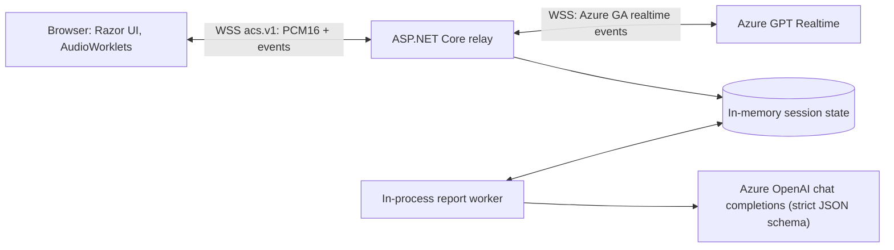

# Advisor Coach Studio

A web-based communication practice tool for financial advisors. You play the advisor; an AI voice plays a
fictional client with consistent circumstances, concerns, and personality. After a short conversation (up to
2 minutes by default) you get a structured coaching report whose every observation is grounded in exact quotes
from your transcript.

> **Not financial advice.** Advisor Coach Studio evaluates communication skills only. It does not evaluate
> investment performance, certify regulatory compliance, or give personalized investment advice. All clients
> and scenarios are fictional.

**Status:** MVP implemented and covered by automated tests that use a local fake provider. Against real Azure
deployments, the provider-level live check (session setup and system instructions, opening, transcription, replies,
interruption and truncation, and coaching reports) and an opt-in browser end-to-end test have passed; see
[tools/AdvisorCoachStudio.LiveCheck](tools/AdvisorCoachStudio.LiveCheck/README.md) and the verification record in
[docs/operations.md](docs/operations.md#live-azure-verification). Some manual checklist items (every scenario,
latency measurements, forced provider errors) are still open, so treat the live experience as **not yet fully
live-verified**.

## Features

- **Practise → Reflect → Observe → Retry** learning loop.
- Three scenarios (worried investor after a market decline, skeptical client questioning fees, overwhelmed
  first-time investor) at Beginner, Intermediate, and Advanced difficulty.
- Real-time voice conversation using **Azure GPT Realtime over WebSockets**: browser → this app → Azure.
  No WebRTC, and Azure credentials never reach the browser.
- Browser audio with `AudioWorklet` capture/playback, correct resampling to/from 24 kHz PCM16, mute,
  natural interruptions (with server-side truncation to what was actually heard), and a hard duration cap.
- Server-authoritative transcripts with honest incomplete/interrupted markers.
- Coaching reports from a separate Azure OpenAI text deployment using strict structured outputs, with
  server-side validation that every quote is an exact substring of the cited turn and server-computed scores.
- Optional spoken AI-as-advisor demonstration that never affects your report.
- **No database and no persistent storage.** Session state lives in server memory; starting a new session,
  signing out, or restarting the app discards it. No raw audio is ever stored.
- Shared access-code gate with anonymous per-browser ownership.

## Architecture



- `src/AdvisorCoachStudio.Web` — the single ASP.NET Core application (.NET 10, Razor Pages, minimal APIs).
- `tests/AdvisorCoachStudio.UnitTests` — unit and protocol tests.
- `tests/AdvisorCoachStudio.IntegrationTests` — end-to-end tests against a local fake Azure realtime WebSocket server.
- `tests/browser` — Playwright browser tests (synthetic microphone).
- `docs/` — [configuration](docs/configuration.md), [deployment](docs/deployment.md), [application protocol](docs/application-protocol.md),
  [Azure realtime protocol](docs/azure-realtime-protocol.md), and [operations](docs/operations.md).
- `infra/` and `azure.yaml` — Azure Developer CLI template (App Service, Key Vault, Application Insights).
- [`advisor_coach_studio_design.md`](advisor_coach_studio_design.md) — the full product and technical design.

## Quick start

Prerequisites: [.NET SDK 10.0.403+](https://dotnet.microsoft.com/download) (pinned in `global.json`) and a current
Microsoft Edge or Google Chrome.

```bash
git clone https://github.com/swapnilgawade16/advisor-coach-studio.git
cd advisor-coach-studio
dotnet user-secrets --project src/AdvisorCoachStudio.Web set "AccessGate:SharedCode" "<choose-a-code>"
dotnet run --project src/AdvisorCoachStudio.Web --launch-profile https
```

Open the printed URL, enter your access code, and browse the scenarios. Without Azure configuration the app runs in
`Unconfigured` mode: scenario browsing and the microphone check work, and live actions clearly show
**Azure setup required**.

### Try the full flow without Azure (development only)

```bash
dotnet run --project src/AdvisorCoachStudio.Web --launch-profile simulation
```

`DevelopmentSimulation` mode uses a clearly labelled in-memory simulator ("Simulated development data - not Azure").
Client speech is a synthetic tone with scripted text, your speech is detected but **not** transcribed, and reports
show layout only. It refuses to start outside the `Development` environment and is never used as a fallback.

### Connect Azure

See [docs/configuration.md](docs/configuration.md) for every setting. Minimal API-key example (placeholders only —
never commit secrets):

```bash
cd src/AdvisorCoachStudio.Web
dotnet user-secrets set "Ai:Mode" "Azure"
dotnet user-secrets set "AzureRealtime:Endpoint" "https://<resource>.openai.azure.com"
dotnet user-secrets set "AzureRealtime:Deployment" "<realtime-deployment-name>"
dotnet user-secrets set "AzureRealtime:Authentication" "ApiKey"
dotnet user-secrets set "AzureRealtime:ApiKey" "<key>"
dotnet user-secrets set "AzureRealtime:TranscriptionModel" "<transcription-model-or-deployment>"
dotnet user-secrets set "AzureReports:Endpoint" "https://<resource>.openai.azure.com"
dotnet user-secrets set "AzureReports:Deployment" "<structured-output-capable-deployment>"
dotnet user-secrets set "AzureReports:Authentication" "ApiKey"
dotnet user-secrets set "AzureReports:ApiKey" "<key>"
```

### Deploy to Azure

`azd up` deploys the app to Azure App Service (Linux, single always-on instance) with Key Vault for the access code
and API key, and Application Insights. See [docs/deployment.md](docs/deployment.md).

## Tests

```bash
dotnet test tests/AdvisorCoachStudio.UnitTests
dotnet test tests/AdvisorCoachStudio.IntegrationTests
# Browser tests need a Chromium-based browser; see tests/browser/README.md
dotnet test tests/browser
```

No Azure credentials are needed for any automated test. Mock-based results are not evidence of live Azure behaviour
or latency.

## Privacy and data handling

- Audio is streamed to Azure AI for the conversation and transcription and is never stored by this application.
- Transcripts and reports exist only in server memory for the current session and are discarded when you start a new
  session, sign out, discard the session, the access cookie expires, or the app restarts.
- Logs and telemetry contain metadata only (IDs, durations, counts, error codes) — never transcript text or audio.
- Provider-side processing and retention are governed by your Azure resource configuration and Microsoft's service
  terms, not by this application.

## Contributing

Contributions are welcome — see [CONTRIBUTING.md](CONTRIBUTING.md), the [code of conduct](CODE_OF_CONDUCT.md), and
[SECURITY.md](SECURITY.md) for reporting vulnerabilities.

## License

[MIT](LICENSE)
